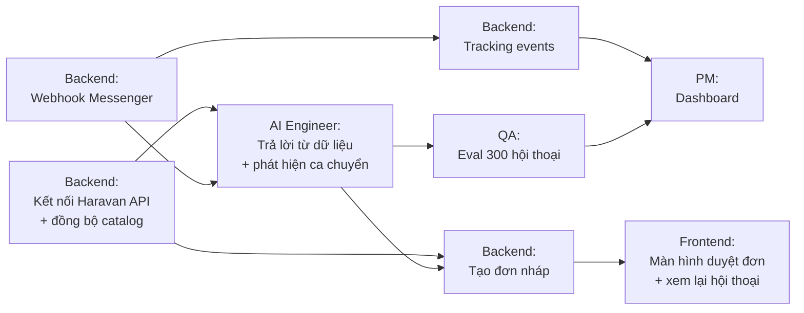

# 09 — Delivery: Roadmap, Dependency Map & Roles

| Input | Process | Output → khâu sau |
|---|---|---|
| PRD ([03](03-prd.md)) + Risk ([08](08-risk.md)) | Chia việc theo luồng phụ thuộc, xếp thứ tự, phân vai | Kế hoạch 3 sprint, ai làm việc trực tiếp với ai |

> Đội giả định cho kế hoạch: **PM, 1 Backend, 1 AI Engineer, 1 Frontend, 1 QA part-time.** **[Giả định]**

## 1. Ưu tiên (RICE rút gọn)

| Tính năng | Reach | Impact | Confidence | Effort | Thứ tự |
|---|---|---|---|---|---|
| US-02 Trả lời giá / size / tồn kho / ship | Mọi hội thoại | Cao | Trung bình (chờ discovery) | Trung bình | **1** |
| US-04 Chuyển người | Mọi ca khó | Cao (giảm rủi ro R1, R3) | Cao | Thấp | **1** |
| US-01 Kết nối Haravan + Fanpage | Mọi shop | Cao (quyết định TTFV) | Cao | Trung bình | **1** |
| US-03 Đơn nháp | Hội thoại chốt | Cao | Trung bình | Trung bình | **2** |
| US-06 Xem lại + đánh dấu sai | Chủ shop | Trung bình (xây niềm tin) | Trung bình | Thấp | **2** |
| US-05 Bật/tắt theo giờ | Chủ shop | Thấp | Cao | Thấp | **3** |

## 2. Dependency map

Phân vai theo **luồng phụ thuộc**, không chia đều. Ai giao đầu ra cho ai thì **làm việc trực tiếp** với người đó, không qua PM.

| Cặp làm việc trực tiếp | Vì sao |
|---|---|
| Backend ↔ AI Engineer | Định dạng dữ liệu catalog quyết định AI trả lời được gì |
| AI Engineer ↔ QA | Bộ eval quyết định AI có được mở rộng không |
| Backend ↔ Frontend | API đơn nháp là đầu vào của màn hình duyệt |
| PM ↔ tất cả | PM giữ PRD, ưu tiên, định nghĩa event; **không** làm trung gian chuyển thông tin kỹ thuật |

## 3. Roadmap 3 sprint (mỗi sprint 2 tuần)

| Sprint | Mục tiêu | Xong khi |
|---|---|---|
| **1 — Trả lời được** | US-01, US-02, US-04 | 1 shop thử kết nối được; AI trả lời đúng trên 50 hội thoại mẫu |
| **2 — Chốt được** | US-03, US-06, tracking events | Đơn nháp tạo đúng; các event bắn đủ cho dashboard |
| **3 — Tin được** | Eval 300 hội thoại, US-05, sửa lỗi | 0 lỗi sai giá; sẵn sàng pilot 5 shop |

## 4. Nhịp làm việc

| Nhịp | Nội dung |
|---|---|
| Hằng ngày (15') | Mỗi người: đã xong gì, đang chặn ở đâu, cần ai |
| Đầu sprint | Chốt mục tiêu sprint từ roadmap, chia việc theo dependency map |
| Cuối sprint | Demo + xem đèn dashboard + cập nhật [decision log](10-decision-log.md) |
| Hằng tuần | PM đọc mẫu hội thoại (xem [08](08-risk.md)) |
