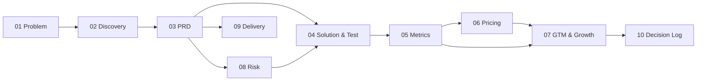

# CaTối — AI Product Management Case Study

> **CaTối**: AI trực inbox Fanpage ca tối cho shop thời trang bán qua Haravan. AI trả lời các câu hỏi về giá, size, còn hàng, phí ship và lên đơn nháp để chủ shop xác nhận.
>
> **Tác giả:** Nguyễn Văn Biển · AI Thực Chiến Khóa IV, Track 1 – AI Product Manager · 10/2026

> ⚠️ **Trạng thái:** đây là **case study**, chưa phải sản phẩm đang có khách. Số tài chính là **số mô hình** (từ bài Day 22–23 của Track 1). Discovery đang chờ phỏng vấn thật: [`02-discovery/`](02-discovery/). Mọi chỗ là giả định đều ghi rõ là **[Giả định]**.

---

## 1. Cách tôi tiếp cận

| Nguyên tắc | Nghĩa là gì trong repo này |
|---|---|
| **Hiểu bản chất trước (First Principles)** | Trước khi bàn tính năng, trả lời: vấn đề này vì sao tồn tại, ai chịu thiệt, đo bằng gì. Xem [01-problem.md](01-problem.md) |
| **Mỗi khâu là Input → Process → Output** | Mỗi file bắt đầu bằng ô "Nhận gì từ khâu trước → Làm gì → Giao gì cho khâu sau" |
| **Nhìn hệ quả đầu cuối (Systems Thinking)** | Mỗi quyết định lớn được ghi kèm ảnh hưởng tới sản phẩm, giá, thị trường và tiến độ. Xem [10-decision-log.md](10-decision-log.md) |
| **Phân vai theo luồng phụ thuộc** | Ai giao đầu ra cho ai thì làm việc trực tiếp với người đó. Xem [09-delivery.md](09-delivery.md) |

## 2. Bản đồ các khâu

| # | Khâu | Input (từ khâu trước) | Output (cho khâu sau) | Trạng thái |
|---|---|---|---|---|
| 01 | [Problem](01-problem.md) | Quan sát thị trường, giả thuyết ban đầu | Problem statement, người dùng mục tiêu, chỉ số thành công | ✅ |
| 02 | [Discovery](02-discovery/) | Problem statement | Pain đã kiểm chứng (hoặc bị bác bỏ), quote thật, workaround | 🔧 Có bộ câu hỏi, chờ phỏng vấn |
| 03 | [PRD](03-prd.md) | Pain đã kiểm chứng | Phạm vi MVP, user stories, tiêu chí nghiệm thu, non-goals | ✅ Bản nháp, cập nhật sau discovery |
| 04 | [Solution & Test](04-solution-options.md) | PRD | 3 phương án theo mức tự chủ của AI, kế hoạch test | ✅ Thiết kế, chưa test |
| 05 | [Metrics](05-metrics.md) | Core action từ PRD | North Star, đèn báo, tracking plan | ✅ |
| 06 | [Pricing](06-pricing.md) | Định nghĩa "job xong" từ Metrics | Giá, biên lợi nhuận, điểm gãy của mô hình | ✅ Số mô hình |
| 07 | [GTM & Growth](07-gtm-growth.md) | Giá + Metrics | Kênh, dashboard vận hành, luật quyết định, cổng 90 ngày | ✅ Số mô hình |
| 08 | [Risk](08-risk.md) | PRD | Rủi ro AI, biện pháp, yêu cầu ngược lại cho PRD | ✅ |
| 09 | [Delivery](09-delivery.md) | PRD + Risk | Roadmap, dependency map, phân vai | ✅ Kế hoạch |
| 10 | [Decision Log](10-decision-log.md) | Mọi khâu | Quyết định + hệ quả đầu cuối | ✅ |

## 3. Năm điều quan trọng nhất

1. **Vấn đề:** ca tối (21h–23h30) là lúc khách nhắn nhiều mà chủ shop đang bận đóng gói. Tin nhắn trả lời chậm thì mất đơn. **[Giả thuyết, chờ phỏng vấn]**
2. **AI chỉ làm phần có đáp án đúng-sai rõ ràng** (giá, size, tồn kho, phí ship) và **chỉ tạo đơn nháp**. Chủ shop luôn là người xác nhận đơn.
3. **North Star:** thời gian tới giá trị đầu tiên (TTFV) ≤ 7 ngày. Shop không thấy giá trị trong pilot thì sẽ không trả tiền.
4. **Giá:** phí tối thiểu 1,56 triệu ₫/tháng + 3.900 ₫/hội thoại xử lý xong, biên lợi nhuận gộp mô hình **68,4%**. Mô hình **gãy** nếu tỷ lệ AI tự xử lý dưới 44% hoặc chi phí LLM tăng 1,8×.
5. **Luật dừng có sẵn từ đầu:** nếu sau một lần sửa mà các chỉ số vẫn dưới ngưỡng thì dừng sản phẩm, không "cố thêm".

## 4. Nguồn

Phần định giá và dashboard dựa trên bài cá nhân của tôi trong Track 1: [Day 22 – Monetization & GTM](https://github.com/nguyenbien8/Track1_Day22_2A202602416_NguyenVanBien), [Day 23 – AI Product Growth](https://github.com/nguyenbien8/K4-L3-DAY23-NguyenVanBien-2A202602416-AIProductGrowth). Phương pháp discovery và test 3 phương án dựa trên [Day 17](https://github.com/nguyenbien8/Track1_Day17_2A202602416_NguyenVanBien), [Day 19](https://github.com/nguyenbien8/Track1_Day19_2A202602416_NguyenVanBien) và [Day 20](https://github.com/nguyenbien8/Track1_Day20_2A202602416_NguyenVanBien).
